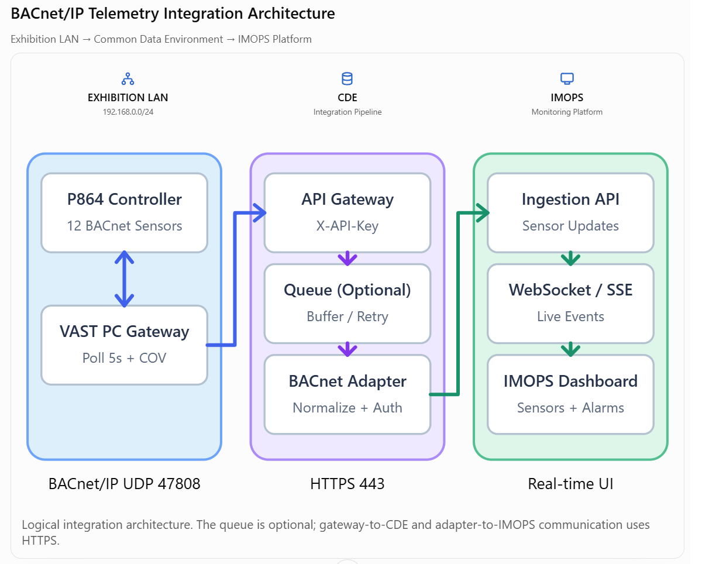

# BACnet Gateway ➔ CDE ➔ IMOPS Integration Plan & Prompts

## 1. Architecture Overview

The end-to-end telemetry and alarm pipeline follows a secure, decoupled 3-tier enterprise pattern:

```mermaid
flowchart LR
    subgraph Site["Exhibition LAN (192.168.0.0/24)"]
        P864["Optergy P864 Controller<br/>Device #864077 (192.168.0.160:47808)<br/>12 BACnet Sensors"]
        GW["VAST PC: bacnet-gw.exe<br/>(zaarr-bacnet-gw-01)<br/>5s Poll + Real-time COV"]
        P864 <-->|"UDP 47808 (BACnet/IP)"| GW
    end

    subgraph CDE["CDE (Common Data Environment)"]
        APIGW["CDE API Gateway<br/>POST /api/v1/bacnet/telemetry<br/>POST /api/v1/bacnet/devices"]
        MQ["CDE Internal Queue (Optional)<br/>RabbitMQ / Kafka / Redis / SQS"]
        ADAPTER["CDE BACnet Adapter<br/>1. Normalize / Massage JSON<br/>2. Authenticate with IMOPS"]
        APIGW --> MQ --> ADAPTER
    end

    subgraph IMOPS["IMOPS Platform"]
        IMOPS_API["IMOPS Ingestion API<br/>POST /api/v1/sensors/bacnet/updates"]
        IMOPS_WS["WebSocket / SSE Stream"]
        IMOPS_UI["IMOPS Live UI Dashboard<br/>(12 Sensors + Alarms + Health)"]
        IMOPS_API --> IMOPS_WS --> IMOPS_UI
    end

    GW -->|"HTTPS POST (Port 443)<br/>X-API-Key"| APIGW
    ADAPTER -->|"HTTPS POST (Port 443)<br/>IMOPS Server Auth"| IMOPS_API
```



<details>
<summary>View Editable Mermaid Diagram</summary>



</details>

### Why This Design?
1. **Zero Risk to Working Production Gateway (`bacnet-gw ➔ CDE API GW` via HTTPS POST):**
   - `bacnet-gw.exe` already includes batched HTTPS POST delivery (`1.5s` flush), exponential backoff retries, authentication (`api_key`, `bearer`, `basic`, `login`), and live delivery counters on `http://127.0.0.1:8090`.
   - Connecting to CDE requires **only updating `config.production.yaml`**—no Go code edits, no recompilation, and no inbound or custom broker firewall ports (`8883`/`5671`/`9092`) on the exhibition LAN.
2. **Security & Credential Isolation:**
   - CDE API Gateway validates `X-API-Key` at the perimeter over standard `HTTPS (443)`.
   - IMOPS production credentials remain strictly server-to-server inside CDE and never sit on the exhibition PC.
3. **Schema Decoupling ("Massaging" in CDE):**
   - If IMOPS updates its API contract, field names, sensor UUIDs, or token auth rules in the future, only the CDE adapter is updated—the site gateway remains untouched.
4. **Optional Internal Queue Inside CDE:**
   - CDE API Gateway can enqueue incoming batches onto CDE's internal MQ (returning `202 Accepted` immediately to `bacnet-gw`) so a CDE worker can buffer and retry safely if IMOPS undergoes maintenance. (Alternatively, CDE can transform and forward directly in-process since load is ~12 requests/minute.)

---

## 2. Master Catalog of the 12 Production BACnet Sensors

All 12 points reside on **Optergy P864 (`device_id: 864077`, `192.168.0.160:47808`)** as configured in `config.production.yaml`:

### A. Wireless Environmental Sensors (5 Analog Points via `BG-1000-M`)
| # | `short_object_id` | BACnet `object_id` | `dashboard_label` (Group) | `property_label` (Metric) | Unit | Value Type |
|---|---|---|---|---|---|---|
| 1 | `AI-101` | `analog-input:101` | `BW-INT-M` | Temperature | `°C` | Float (2 decimals) |
| 2 | `AI-102` | `analog-input:102` | `BW-INT-M` | Humidity | `%RH` | Float (2 decimals) |
| 3 | `AV-27126` | `analog-value:27126` | `BW-INT-M` | Temperature Setpoint | `°C` | Float (2 decimals) |
| 4 | `AI-201` | `analog-input:201` | `BW-TH-M` | Temperature | `°C` | Float (2 decimals) |
| 5 | `AI-202` | `analog-input:202` | `BW-TH-M` | Humidity | `%RH` | Float (2 decimals) |

### B. Wired Safety, Power & Security Dry Contacts (7 Binary Points `BI-1` to `BI-7`)
| # | `short_object_id` | BACnet `object_id` | `dashboard_label` | `property_label` | Physical Input | `value=0` (`inactive_text`) | `value=1` (`active_text`) | Severity when `value=1` |
|---|---|---|---|---|---|---|---|---|
| 6 | `BI-1` | `binary-input:1` | `WD3` | Water detected | IN 1 (LED 1) | `Normal` | `Water Detected` | **ALARM** (`is_alarm: true`) |
| 7 | `BI-2` | `binary-input:2` | `MSA237D 99` | Motion / presence detected | IN 2 (LED 2) | `Clear` | `Motion Detected` | **EVENT** (`is_triggered: true`, `is_alarm: false`) |
| 8 | `BI-3` | `binary-input:3` | `Fire Detection Sensor` | Fire alarm contact activated | IN 3 (LED 3) | `Normal` | `Fire Alarm` | **ALARM** (`is_alarm: true`) |
| 9 | `BI-4` | `binary-input:4` | `PERIMETER INTRUSION (MAXIBUS)` | Intrusion Detector | IN 4 (LED 4) | `Secure` | `Intrusion Detected` | **ALARM** (`is_alarm: true`) |
| 10 | `BI-5` | `binary-input:5` | `UPS MONITORING` | UPS on battery / power failure | IN 5 (LED 5) | `Mains OK` | `UPS On Battery / Failure` | **ALARM** (`is_alarm: true`) |
| 11 | `BI-6` | `binary-input:6` | `Access Control System` | Unauthorized access / door forced open | IN 6 (LED 6) | `Secure` | `Door Forced Open` | **ALARM** (`is_alarm: true`) |
| 12 | `BI-7` | `binary-input:7` | `Server Rack Door Contact` | Rack door opened without authorization | IN 7 (LED 7) | `Closed` | `Rack Door Opened` | **ALARM** (`is_alarm: true`) |

---

## 3. Production Gateway Configuration (`bacnet-gw ➔ CDE Kong API Gateway`)

### CDE Kong API Gateway Endpoints & Credentials

| Setting | Configured Value for `zaarr-bacnet-gw-01` |
| :--- | :--- |
| **Production API Gateway Base URL (HTTPS)** | `https://isems-office-cde.somesolutions.xyz` (`verify_tls: true`) |
| **Local Dev API Gateway Base URL (HTTP)** | `http://localhost:8088` *(or `http://<CDE_SERVER_IP>:8088`)* |
| **1. Sensor Telemetry Push Endpoint** | `POST /api/v1/bacnet/telemetry`<br>Prod URL: `https://isems-office-cde.somesolutions.xyz/api/v1/bacnet/telemetry` |
| **2. Controller Discovery / Status Endpoint** | `POST /api/v1/bacnet/devices`<br>Prod URL: `https://isems-office-cde.somesolutions.xyz/api/v1/bacnet/devices` |
| **3. CDE Data Mart Verification Endpoint** | `GET /api/v1/bacnet/status`<br>Prod URL: `https://isems-office-cde.somesolutions.xyz/api/v1/bacnet/status?apikey=zaarr-bacnet-gw01-key-2026` |
| **Authentication Header** | `X-API-Key: zaarr-bacnet-gw01-key-2026` |
| **Content-Type / User-Agent** | `Content-Type: application/json` / `User-Agent: zaarr-bacnet-gw/1.0` |
| **Expected Success Response** | `HTTP 202 Accepted` (`{"status": "accepted", ...}`) |

### Ready-to-Use Block in `config.production.yaml`
*(Important: If the VAST PC is still running yesterday's `bacnet-gw.exe`, use the **`imops:`** block below—it works without updating the `.exe`. If you copy today's updated `bacnet-gw.exe` onto the VAST PC, **both** `imops:` and `cde:` blocks work identically.)*

```yaml
# Option A (Recommended — works with BOTH existing and newly built bacnet-gw.exe):
imops:
  enabled: true
  base_url: "https://isems-office-cde.somesolutions.xyz"
  telemetry_path: "/api/v1/bacnet/telemetry"
  devices_path: "/api/v1/bacnet/devices"
  packet_events_path: "/api/v1/bacnet/packets" # Only used if polling.forward_packet_events: true
  auth_type: "api_key"
  api_key_header: "X-API-Key"
  api_key: "zaarr-bacnet-gw01-key-2026"
  batch_max_points: 100
  flush_interval_ms: 1500
  http_timeout_ms: 10000
  verify_tls: true
  max_retries: 3
  retry_base_backoff_ms: 500
  dry_run_log_payloads: false

# Option B (Alias supported in newly built bacnet-gw.exe from 2026-11-13+):
cde:
  enabled: true
  base_url: "https://isems-office-cde.somesolutions.xyz"
  telemetry_endpoint: "/api/v1/bacnet/telemetry"
  devices_endpoint: "/api/v1/bacnet/devices"
  api_key: "zaarr-bacnet-gw01-key-2026"
  auth_header: "X-API-Key"
  timeout_seconds: 10
  verify_tls: true
```

After restarting the Windows service on the VAST PC, open:
1. Local Gateway Dashboard (`http://127.0.0.1:8090` on VAST PC) — confirm **IMOPS API Delivery** shows `Batches` and `Readings` incrementing with `Failed: 0`.
2. Production CDE Data Mart Status (`https://isems-office-cde.somesolutions.xyz/api/v1/bacnet/status?apikey=zaarr-bacnet-gw01-key-2026`) — confirm the 12 points are stored in production CDE.

---

## 4. Outbound Gateway Endpoints Explained & Sample Payloads

`bacnet-gw` defines three outbound paths in `config.production.yaml`. Here is how they differ and the exact JSON payload each sends:

| Config Key | Route | Purpose | When It Fires | Active in Production? |
| :--- | :--- | :--- | :--- | :--- |
| **`telemetry_path`** | `POST /api/v1/bacnet/telemetry` | **12 Sensor Readings & Alarms** (`AI-101`, `AI-102`, `AV-27126`, `AI-201`, `AI-202`, `BI-1`..`BI-7`) | Every **5 seconds** (`poll`) + **immediately** on real-time COV change (`cov`) | **YES** (Main sensor stream) |
| **`devices_path`** | `POST /api/v1/bacnet/devices` | **Optergy P864 Controller Hardware Health** (`online: true/false`, IP, model, firmware) | On discovery, every 10m metadata sync, after **2 missed polls (~10s)** when P864 goes offline, and on recovery | **YES** (Prevents stale UI if P864 loses power/LAN) |
| **`packet_events_path`** | `POST /api/v1/bacnet/packets` | **Raw UDP 47808 Wire Packet Audit** (low-level `BVLC`/`APDU` frame headers, Wireshark-style) | Only when `polling.forward_packet_events: true` | **NO — Disabled** (`forward_packet_events: false`) |

---

### 4.1 `telemetry_path` — `POST /api/v1/bacnet/telemetry`
Carries batched readings for the 12 sensors (`source_type: "poll"` every 5s, or `source_type: "cov"` on instant change):

```json
{
  "gateway_id": "zaarr-bacnet-gw-01",
  "site_name": "Smart Nation Exhibition System",
  "batch_id": "20261113T055500Z-18",
  "sent_at": "2026-11-13T05:55:00Z",
  "count": 2,
  "readings": [
    {
      "timestamp": "2026-11-13T05:54:59.810Z",
      "source_type": "poll",
      "device_id": 864077,
      "device_name": "P864-864077",
      "controller_model": "P864",
      "device_address": "192.168.0.160:47808",
      "object_type": "analog-input",
      "object_instance": 101,
      "object_id": "analog-input:101",
      "short_object_id": "AI-101",
      "point_name": "BW-INT-M (WIRELESS AIR TOUCH DISPLAY)",
      "property_label": "Temperature",
      "dashboard_label": "BW-INT-M",
      "connection_bus": "BG-1000-M (Wireless)",
      "value": 23.45,
      "value_text": "23.45 °C",
      "unit": "°C",
      "unit_id": 62,
      "is_triggered": false,
      "is_alarm": false,
      "quality": "good",
      "status_flags": {
        "in_alarm": false,
        "fault": false,
        "overridden": false,
        "out_of_service": false
      }
    },
    {
      "timestamp": "2026-11-13T05:54:59.920Z",
      "source_type": "cov",
      "device_id": 864077,
      "device_name": "P864-864077",
      "controller_model": "P864",
      "device_address": "192.168.0.160:47808",
      "object_type": "binary-input",
      "object_instance": 1,
      "object_id": "binary-input:1",
      "short_object_id": "BI-1",
      "point_name": "WD3 (WATER LEAK)",
      "property_label": "Water detected",
      "dashboard_label": "WD3",
      "connection_bus": "IN 1 • Dry Contact (LED 1)",
      "value": 1,
      "value_text": "Water Detected",
      "is_triggered": true,
      "is_alarm": true,
      "quality": "alarm",
      "status_flags": {
        "in_alarm": false,
        "fault": false,
        "overridden": false,
        "out_of_service": false
      }
    }
  ]
}
```

---

### 4.2 `devices_path` — `POST /api/v1/bacnet/devices`
Reports the connectivity & hardware profile of the **Optergy P864 controller (`#864077`)** itself. Because `/telemetry` stops sending readings if the P864 loses power or Ethernet, `/devices` explicitly alerts CDE & IMOPS within ~10 seconds (2 missed polls) that the controller is offline.

**Sample A — Controller Online (Discovery / Recovery):**
```json
{
  "gateway_id": "zaarr-bacnet-gw-01",
  "site_name": "Smart Nation Exhibition System",
  "sent_at": "2026-11-13T05:55:00Z",
  "device": {
    "device_id": 864077,
    "object_name": "P864-864077",
    "model_name": "P864",
    "vendor_name": "Optergy",
    "vendor_id": 515,
    "firmware_revision": "2.4.0",
    "controller_role": "field_controller",
    "address": "192.168.0.160:47808",
    "online": true,
    "communication_status": "online",
    "point_count": 12,
    "discovered_at": "2026-11-13T00:00:05Z"
  }
}
```

**Sample B — Controller Unreachable (After 2 Missed Polls / ~10s):**
```json
{
  "gateway_id": "zaarr-bacnet-gw-01",
  "site_name": "Smart Nation Exhibition System",
  "sent_at": "2026-11-13T05:56:10Z",
  "device": {
    "device_id": 864077,
    "object_name": "P864-864077",
    "model_name": "P864",
    "vendor_name": "Optergy",
    "vendor_id": 515,
    "firmware_revision": "2.4.0",
    "controller_role": "field_controller",
    "address": "192.168.0.160:47808",
    "online": false,
    "communication_status": "communication_failure",
    "point_count": 12,
    "discovered_at": "2026-11-13T00:00:05Z"
  }
}
```

---

### 4.3 `packet_events_path` — `POST /api/v1/bacnet/packets` *(Optional / Disabled by Default)*
Only active if `polling.forward_packet_events: true` is enabled for deep BACnet/IP network diagnostics (kept `false` in production so CDE Kong does not need this route):

```json
{
  "gateway_id": "zaarr-bacnet-gw-01",
  "site_name": "Smart Nation Exhibition System",
  "sent_at": "2026-11-13T05:55:00Z",
  "count": 1,
  "packets": [
    {
      "timestamp": "2026-11-13T05:54:59.918Z",
      "source": {
        "ip": "192.168.0.160",
        "port": 47808
      },
      "bvlc_function": 10,
      "bvlc_name": "Original-Unicast-NPDU",
      "is_network_msg": false,
      "pdu_type": "Unconfirmed-Request",
      "service_choice": 2,
      "service_name": "Unconfirmed-COV-Notification",
      "length": 42
    }
  ]
}
```

---

## 5. Field Mapping Reference (`BACnet GW ➔ CDE ➔ IMOPS`)

| BACnet Gateway Field (`TelemetryReading`) | CDE Transformation / Logic | IMOPS Field (`sensors[]`) | Example Value |
|---|---|---|---|
| `short_object_id` | Direct copy (or lookup IMOPS UUID if required) | `sensor_id` | `"AI-101"` / `"BI-1"` |
| `dashboard_label` | Direct copy | `group` | `"BW-INT-M"` / `"WD3"` |
| `point_name` | Direct copy | `sensor_name` | `"WD3 (WATER LEAK)"` |
| `property_label` | Direct copy | `metric` | `"Water detected"` |
| `object_type` | `"analog-*"` ➔ `"environmental"`; `"binary-*"` ➔ `"safety_security"` | `category` | `"safety_security"` |
| `value` | Direct copy (`float` for analog, `0`/`1` for binary) | `value` | `23.45` or `1` |
| `unit` | Direct copy (`""` if empty) | `unit` | `"°C"`, `"%RH"`, `""` |
| `value_text` | Direct copy | `display_text` | `"23.45 °C"` / `"Water Detected"` |
| `is_triggered` | Direct copy | `is_triggered` | `true` |
| `is_alarm` | Direct copy | `is_alarm` | `true` |
| `status_flags` + `is_alarm` + `is_triggered` | `fault`/`out_of_service` ➔ `"fault"`; else `is_alarm` ➔ `"alarm"`; else `is_triggered` ➔ `"event"`; else `"normal"` | `severity` | `"alarm"` |
| `source_type` | Direct copy (`"poll"` or `"cov"`) | `update_type` | `"cov"` |
| `timestamp` | Direct copy (ISO-8601 UTC) | `updated_at` | `"2026-11-13T01:19:59.850Z"` |

---

## 6. Prompt for CDE Team (Copy-Paste Ready)

````markdown
# Task: Build CDE BACnet Ingestion & Transformation Adapter (BACnet GW ➔ CDE ➔ IMOPS)

## Context & Architecture
Our deployed **BACnet/IP Edge Gateway (`zaarr-bacnet-gw-01`)** at the **Smart Nation Exhibition System** monitors an Optergy P864 controller (`device_id: 864077` at `192.168.0.160:47808`) with **12 BACnet sensors** (5 wireless environmental points + 7 safety/security dry contacts).

Data flows as:
`BACnet Edge Gateway (HTTPS POST) ➔ CDE API Gateway ➔ [Optional CDE Internal MQ] ➔ CDE Adapter (Massage + Auth) ➔ IMOPS API`

Please implement the CDE side of this pipeline:
1. **CDE API Gateway Ingestion Endpoints** secured with `X-API-Key` to accept batched telemetry and controller status from `zaarr-bacnet-gw-01`.
2. **Internal Queuing / Buffering (if standard in CDE):** Publish inbound batches to CDE's internal queue and return `202 Accepted` (or `200 OK`) immediately so edge requests complete in <50ms, with worker retries if IMOPS is temporarily unreachable.
3. **Payload Transformation ("Massaging"):** Normalize raw BACnet telemetry into IMOPS's clean 12-sensor dashboard schema.
4. **IMOPS Outbound Client:** Authenticate against IMOPS (supporting static API key / Bearer token or cached JWT login refresh on `401`) and `POST` the transformed updates to IMOPS.

---

## 1. Inbound Endpoints on CDE API Gateway (Edge Gateway ➔ CDE)

All requests from `zaarr-bacnet-gw-01` use:
- `Content-Type: application/json`
- `User-Agent: zaarr-bacnet-gw/1.0`
- `X-API-Key: <CDE_API_KEY>`
- Gateway retries automatically with exponential backoff on `HTTP 429` and `5xx`. Return `200 OK` or `202 Accepted` with `{"status": "accepted"}` on success.

### Endpoint A: `POST /api/v1/bacnet/telemetry`
Sent every ~1.5s–5s (5-second poll batches + immediate real-time COV notifications when dry contacts or values change).
```json
{
  "gateway_id": "zaarr-bacnet-gw-01",
  "site_name": "Smart Nation Exhibition System",
  "batch_id": "20261113T012000Z-42",
  "sent_at": "2026-11-13T01:20:00Z",
  "count": 2,
  "readings": [
    {
      "timestamp": "2026-11-13T01:19:59.812Z",
      "source_type": "poll",
      "device_id": 864077,
      "device_name": "P864-864077",
      "controller_model": "P864",
      "device_address": "192.168.0.160:47808",
      "object_type": "analog-input",
      "object_instance": 101,
      "object_id": "analog-input:101",
      "short_object_id": "AI-101",
      "point_name": "BW-INT-M (WIRELESS AIR TOUCH DISPLAY)",
      "property_label": "Temperature",
      "dashboard_label": "BW-INT-M",
      "connection_bus": "BG-1000-M (Wireless)",
      "value": 23.45,
      "value_text": "23.45 °C",
      "unit": "°C",
      "unit_id": 62,
      "is_triggered": false,
      "is_alarm": false,
      "quality": "good",
      "status_flags": {
        "in_alarm": false,
        "fault": false,
        "overridden": false,
        "out_of_service": false
      }
    },
    {
      "timestamp": "2026-11-13T01:19:59.850Z",
      "source_type": "cov",
      "device_id": 864077,
      "device_name": "P864-864077",
      "controller_model": "P864",
      "device_address": "192.168.0.160:47808",
      "object_type": "binary-input",
      "object_instance": 1,
      "object_id": "binary-input:1",
      "short_object_id": "BI-1",
      "point_name": "WD3 (WATER LEAK)",
      "property_label": "Water detected",
      "dashboard_label": "WD3",
      "connection_bus": "IN 1 • Dry Contact (LED 1)",
      "value": 1,
      "value_text": "Water Detected",
      "is_triggered": true,
      "is_alarm": true,
      "quality": "alarm",
      "status_flags": {
        "in_alarm": false,
        "fault": false,
        "overridden": false,
        "out_of_service": false
      }
    }
  ]
}
```

### Endpoint B: `POST /api/v1/bacnet/devices`
Sent on controller discovery, metadata sync, communication failure (`online: false`), and recovery (`online: true`). Cache the latest controller health state in CDE so it can also be attached to outbound IMOPS payloads and forwarded to IMOPS's controller status endpoint.
```json
{
  "gateway_id": "zaarr-bacnet-gw-01",
  "site_name": "Smart Nation Exhibition System",
  "sent_at": "2026-11-13T01:20:00Z",
  "device": {
    "device_id": 864077,
    "object_name": "P864-864077",
    "model_name": "P864",
    "vendor_name": "Optergy",
    "vendor_id": 515,
    "firmware_revision": "2.4.0",
    "address": "192.168.0.160:47808",
    "online": true,
    "communication_status": "online",
    "point_count": 12,
    "discovered_at": "2026-11-13T00:00:05Z"
  }
}
```

---

## 2. Transformation Rules in CDE (Massage for IMOPS)

Transform each `TelemetryBatchEnvelope` into the clean IMOPS payload below:
1. **`sensor_id`:** Map from `short_object_id` (`AI-101`, `AI-102`, `AV-27126`, `AI-201`, `AI-202`, `BI-1`..`BI-7`). Maintain a configurable lookup map in CDE in case IMOPS later maps `short_object_id` to internal IMOPS asset UUIDs.
2. **`category`:**
   - `"environmental"` when `object_type` starts with `"analog-"` (`AI-101`, `AI-102`, `AV-27126`, `AI-201`, `AI-202`)
   - `"safety_security"` when `object_type` starts with `"binary-"` (`BI-1`..`BI-7`)
3. **`severity`:**
   - `"fault"` if `status_flags.fault == true` or `status_flags.out_of_service == true` or `quality == "fault"`
   - `"alarm"` if `is_alarm == true`
   - `"event"` if `is_triggered == true` and `is_alarm == false` (e.g., `BI-2` Motion Detected)
   - `"normal"` otherwise
4. **Other fields:**
   - `group` ⬅ `dashboard_label`
   - `sensor_name` ⬅ `point_name`
   - `metric` ⬅ `property_label`
   - `value` ⬅ `value`
   - `unit` ⬅ `unit` (default `""`)
   - `display_text` ⬅ `value_text`
   - `update_type` ⬅ `source_type` (`"poll"` or `"cov"`)
   - `updated_at` ⬅ `timestamp`

### Outbound Payload Sent by CDE ➔ IMOPS (`POST /api/v1/sensors/bacnet/updates`)
```json
{
  "site_name": "Smart Nation Exhibition System",
  "gateway_id": "zaarr-bacnet-gw-01",
  "batch_id": "20261113T012000Z-42",
  "controller": {
    "device_id": 864077,
    "name": "P864-864077",
    "model": "P864",
    "ip_address": "192.168.0.160",
    "online": true,
    "communication_status": "online"
  },
  "sent_at": "2026-11-13T01:20:00Z",
  "sensors": [
    {
      "sensor_id": "AI-101",
      "group": "BW-INT-M",
      "sensor_name": "BW-INT-M (WIRELESS AIR TOUCH DISPLAY)",
      "metric": "Temperature",
      "category": "environmental",
      "value": 23.45,
      "unit": "°C",
      "display_text": "23.45 °C",
      "severity": "normal",
      "is_triggered": false,
      "is_alarm": false,
      "update_type": "poll",
      "updated_at": "2026-11-13T01:19:59.812Z"
    },
    {
      "sensor_id": "BI-1",
      "group": "WD3",
      "sensor_name": "WD3 (WATER LEAK)",
      "metric": "Water detected",
      "category": "safety_security",
      "value": 1,
      "unit": "",
      "display_text": "Water Detected",
      "severity": "alarm",
      "is_triggered": true,
      "is_alarm": true,
      "update_type": "cov",
      "updated_at": "2026-11-13T01:19:59.850Z"
    }
  ]
}
```
Also forward controller connectivity changes from `/api/v1/bacnet/devices` to IMOPS (`POST /api/v1/sensors/bacnet/controller-status`) when `device.online` changes.

---

## Deliverables Needed Back for Edge Gateway Setup
1. CDE API Gateway `base_url` (e.g. `https://cde-api.example.com`)
2. Confirmed paths (`/api/v1/bacnet/telemetry` and `/api/v1/bacnet/devices`)
3. `X-API-Key` secret for `zaarr-bacnet-gw-01`
````

---

## 7. Prompt for IMOPS Team (Copy-Paste Ready)

````markdown
# Task: Build IMOPS Sensor Ingestion APIs & Live 12-Sensor UI Dashboard

## Context & Architecture
Data for the **Smart Nation Exhibition System** BACnet sensors flows through CDE into IMOPS:
`BACnet Edge Gateway ➔ CDE (Auth + Payload Normalization) ➔ IMOPS Ingestion API ➔ IMOPS UI Dashboard`

CDE will push normalized updates for **12 BACnet sensors** every ~5 seconds (and immediately in real time whenever a sensor/alarm state changes via COV).

Please build:
1. **IMOPS REST Ingestion Endpoints** (authenticated server-to-server for CDE) to receive sensor updates and controller connectivity status.
2. **Real-Time Frontend Feed** (WebSocket, Server-Sent Events, or fast polling) from IMOPS Backend to IMOPS UI.
3. **IMOPS Live UI Dashboard** displaying controller health, active alarm KPIs, grouped wireless environmental readings, and live safety/security dry-contact alarm states.

---

## 1. Authentication (CDE ➔ IMOPS)
Please secure the ingestion endpoints using your standard server-to-server authentication and share the credentials with the CDE team:
- **Option A (Simple M2M):** `X-API-Key: <secret>` or static `Authorization: Bearer <token>`
- **Option B (OAuth2 / JWT Login):** Login endpoint returning a Bearer token (CDE will cache the token and refresh on `401 Unauthorized`).

---

## 2. IMOPS REST APIs to Provide to CDE

### Endpoint 1: Batch Sensor State Upsert
- **Route:** `POST /api/v1/sensors/bacnet/updates` *(or your preferred IMOPS route convention)*
- **Behavior:**
  1. Upsert the current live state of each sensor in `sensors[]` keyed by `sensor_id`.
  2. Update controller health from `controller`.
  3. Log alarm/event transitions (`severity` changing to/from `"alarm"` or `"event"`) for the dashboard activity log.
  4. Broadcast updated states to connected UI clients immediately.
  5. Return `200 OK` with `{"status": "ok"}`.
- **Request JSON Schema (Sent by CDE):**
```json
{
  "site_name": "Smart Nation Exhibition System",
  "gateway_id": "zaarr-bacnet-gw-01",
  "batch_id": "20261113T012000Z-42",
  "controller": {
    "device_id": 864077,
    "name": "P864-864077",
    "model": "P864",
    "ip_address": "192.168.0.160",
    "online": true,
    "communication_status": "online"
  },
  "sent_at": "2026-11-13T01:20:00Z",
  "sensors": [
    {
      "sensor_id": "AI-101",
      "group": "BW-INT-M",
      "sensor_name": "BW-INT-M (WIRELESS AIR TOUCH DISPLAY)",
      "metric": "Temperature",
      "category": "environmental",
      "value": 23.45,
      "unit": "°C",
      "display_text": "23.45 °C",
      "severity": "normal",
      "is_triggered": false,
      "is_alarm": false,
      "update_type": "poll",
      "updated_at": "2026-11-13T01:19:59.812Z"
    },
    {
      "sensor_id": "BI-1",
      "group": "WD3",
      "sensor_name": "WD3 (WATER LEAK)",
      "metric": "Water detected",
      "category": "safety_security",
      "value": 1,
      "unit": "",
      "display_text": "Water Detected",
      "severity": "alarm",
      "is_triggered": true,
      "is_alarm": true,
      "update_type": "cov",
      "updated_at": "2026-11-13T01:19:59.850Z"
    }
  ]
}
```
- **`severity` values:** `"normal"` | `"event"` | `"alarm"` | `"fault"`
- **`update_type` values:** `"poll"` (5s periodic read) | `"cov"` (instant event change)

### Endpoint 2: Controller Connectivity Alert
- **Route:** `POST /api/v1/sensors/bacnet/controller-status`
- **Behavior:** Immediately mark controller `864077` Online or Offline (`communication_failure`) on the UI dashboard when triggered.
- **Request JSON Schema:**
```json
{
  "gateway_id": "zaarr-bacnet-gw-01",
  "device_id": 864077,
  "name": "P864-864077",
  "model": "P864",
  "ip_address": "192.168.0.160",
  "online": false,
  "communication_status": "communication_failure",
  "timestamp": "2026-11-13T01:31:00Z"
}
```

---

## 3. Specification of the 12 Sensors for the IMOPS UI Dashboard

Use `sensor_id` as the unique identifier:

### A. Environmental Wireless Sensors (`category: "environmental"` — 5 Points)
| `sensor_id` | Widget Group (`group`) | Metric (`metric`) | Unit | Example `display_text` |
|---|---|---|---|---|
| `AI-101` | `BW-INT-M` (Wireless Air Touch Display) | Temperature | `°C` | `23.45 °C` |
| `AI-102` | `BW-INT-M` (Wireless Air Touch Display) | Humidity | `%RH` | `55.2 %RH` |
| `AV-27126` | `BW-INT-M` (Wireless Air Touch Display) | Temperature Setpoint | `°C` | `24 °C` |
| `AI-201` | `BW-TH-M` (Wireless Temp & Humidity) | Temperature | `°C` | `24.1 °C` |
| `AI-202` | `BW-TH-M` (Wireless Temp & Humidity) | Humidity | `%RH` | `58.0 %RH` |

### B. Safety, Power & Security Dry Contacts (`category: "safety_security"` — 7 Points)
| `sensor_id` | Sensor Name (`group`) | Metric (`metric`) | Normal (`value=0`) | Triggered (`value=1`) | Dashboard State when `value=1` |
|---|---|---|---|---|---|
| `BI-1` | `WD3` | Water detected | `Normal` | `Water Detected` | **CRITICAL ALARM (Red)** — `severity: "alarm"` |
| `BI-2` | `MSA237D 99` | Motion / presence detected | `Clear` | `Motion Detected` | **ACTIVE EVENT (Amber)** — `severity: "event"` |
| `BI-3` | `Fire Detection Sensor` | Fire alarm contact activated | `Normal` | `Fire Alarm` | **CRITICAL ALARM (Red)** — `severity: "alarm"` |
| `BI-4` | `PERIMETER INTRUSION (MAXIBUS)` | Intrusion Detector | `Secure` | `Intrusion Detected` | **CRITICAL ALARM (Red)** — `severity: "alarm"` |
| `BI-5` | `UPS MONITORING` | UPS on battery / power failure | `Mains OK` | `UPS On Battery / Failure` | **CRITICAL ALARM (Red)** — `severity: "alarm"` |
| `BI-6` | `Access Control System` | Unauthorized access / door forced open | `Secure` | `Door Forced Open` | **CRITICAL ALARM (Red)** — `severity: "alarm"` |
| `BI-7` | `Server Rack Door Contact` | Rack door opened without authorization | `Closed` | `Rack Door Opened` | **CRITICAL ALARM (Red)** — `severity: "alarm"` |

---

## 4. IMOPS UI Dashboard Layout & Functional Requirements

1. **Top KPI / Health Strip:**
   - **Controller Status Card:** Shows `ONLINE` (Green) or `COMM FAILURE` (Red) for `Optergy P864 (#864077 @ 192.168.0.160)`. Also display a `STALE DATA` warning if no update has been received from CDE for >30 seconds.
   - **Active Alarms Counter:** Count of sensors where `severity == "alarm"` (pulsing red when > 0).
   - **Sensor Sync Status:** `X / 12 Sensors Active` + last received timestamp.

2. **Environmental Telemetry Section:**
   - **Card 1 — `BW-INT-M` (Wireless Air Touch Display):** Displays live Temperature (`AI-101`), Humidity (`AI-102`), and Temperature Setpoint (`AV-27126`) together.
   - **Card 2 — `BW-TH-M` (Wireless Temp & Humidity Sensor):** Displays live Temperature (`AI-201`) and Humidity (`AI-202`) together.

3. **Safety, Power & Security Status Grid (7 Dry Contacts `BI-1`..`BI-7`):**
   - Individual status cards (and/or facility floorplan hotspot badges) with clear color coding:
     - **Green (`normal`):** Normal / Secure / Closed / Mains OK / Clear
     - **Amber Pulsing (`event`):** Motion Detected (`BI-2`)
     - **Red Pulsing (`alarm`):** Water Leak (`BI-1`), Fire Alarm (`BI-3`), Perimeter Intrusion (`BI-4`), UPS Failure (`BI-5`), Door Forced Open (`BI-6`), Rack Door Opened (`BI-7`)
     - **Grey/Orange (`fault`):** Sensor fault or out-of-service

4. **Live Sensor Table & Recent Alarm/Event Feed:**
   - Full 12-row live status table (`sensor_id`, `group`, `metric`, `display_text`, `update_type`, `severity`, `updated_at`).
   - Recent event history showing when alarms/events triggered and cleared.
   - Live UI updates via WebSocket or SSE without requiring manual browser refresh.

---

## Deliverables Needed Back for CDE Integration
1. IMOPS `base_url` and exact endpoint routes for sensor updates & controller status
2. Authentication method & credentials for CDE
3. Any additional required headers or field adjustments
````

---

## 8. Local Simulation & End-to-End CDE Verification Guide

You can test the full 12-sensor pipeline (`mock-exhibition.exe ➔ bacnet-gw.exe ➔ CDE Kong API Gateway`) locally without physical hardware using `config.sim.yaml` and `sim-contacts.ps1`.

### Step 1: Start Local Simulator + Gateway
Ensure CDE (Kong API Gateway) is running on `:8088` (if on another host, set `imops.base_url: "http://<CDE_SERVER_IP>:8088"` in `config.sim.yaml`), then run:

```powershell
.\start-sim.bat
```

This launches:
1. **`mock-exhibition.exe`** — Emulates Optergy P864 (`#864077`) with all 12 sensors on `127.0.0.1:47810` + simulator control API on `http://127.0.0.1:8085`.
2. **`bacnet-gw.exe -config config.sim.yaml`** — Polls all 12 points + listens for real-time COV and pushes batches to CDE Kong (`http://127.0.0.1:8088`) with `X-API-Key: zaarr-bacnet-gw01-key-2026`.
3. **Local Gateway Dashboard** — Opens `http://127.0.0.1:8090` (confirm **IMOPS API Delivery** increments with `Failed: 0`).
4. **Interactive 12-Sensor Controller** — Opens `.\sim-contacts.ps1`.

### Step 2: Simulate Both Discrete Alarms & Continuous Analog Values (`sim-contacts.ps1`)

#### A. Interactive Keyboard Menu (`.\sim-contacts.ps1`)
- **`1` – `7`:** Toggle the 7 discrete dry-contact alarms (`BI-1` Water Leak .. `BI-7` Rack Door) ON (`1`) or OFF (`0`).
- **`8` – `12`:** Enter any custom floating-point reading for the 5 continuous analog sensors:
  - `8` = `AI-101` (BW-INT-M Temperature, `°C`)
  - `9` = `AI-102` (BW-INT-M Humidity, `%RH`)
  - `10` = `AV-27126` (BW-INT-M Temperature Setpoint, `°C`)
  - `11` = `AI-201` (BW-TH-M Temperature, `°C`)
  - `12` = `AI-202` (BW-TH-M Humidity, `%RH`)
- **`C` (Continuous Live Drift):** Automatically fluctuates Temperature & Humidity every **2 seconds** continuously (press any key to pause) to test live streaming into CDE and IMOPS.
- **`R`:** Randomize all 5 analog readings once.
- **`A` / `O` / `D`:** Turn ALL 7 contacts ON (`A`), reset ALL OFF (`O`), or run sequential alarm demo sweep (`D`).

#### B. Direct CLI One-Liners
```powershell
# Set exact continuous analog values (emits immediate BACnet COV -> CDE):
.\sim-contacts.ps1 AI-101 26.8      # BW-INT-M Temperature -> 26.8 °C
.\sim-contacts.ps1 AI-102 61.5      # BW-INT-M Humidity    -> 61.5 %RH
.\sim-contacts.ps1 AV-27126 21.0    # BW-INT-M Setpoint    -> 21.0 °C
.\sim-contacts.ps1 AI-201 27.4      # BW-TH-M Temperature  -> 27.4 °C
.\sim-contacts.ps1 AI-202 65.2      # BW-TH-M Humidity     -> 65.2 %RH

# Start continuous 2-second live analog drift from CLI:
.\sim-contacts.ps1 stream

# Toggle discrete dry-contact alarms from CLI:
.\sim-contacts.ps1 BI-1 on          # Trigger Water Leak Alarm
.\sim-contacts.ps1 all off          # Clear all 7 alarms
```

### Step 3: Verify Data Saved in CDE Data Mart
Open in browser or run via `curl`:
```powershell
curl.exe "http://localhost:8088/api/v1/bacnet/status" -H "X-API-Key: zaarr-bacnet-gw01-key-2026"
# Or in browser: http://localhost:8088/api/v1/bacnet/status?apikey=zaarr-bacnet-gw01-key-2026
```

---

## 9. Rollout & Verification Checklist

- [ ] **Step 1 (IMOPS):** IMOPS deploys ingestion endpoints + dashboard and shares `base_url` + auth credentials with CDE team.
- [x] **Step 2 (CDE Production Deployment):** Production CDE Kong API Gateway live at `https://isems-office-cde.somesolutions.xyz` (`POST /api/v1/bacnet/telemetry`, `POST /api/v1/bacnet/devices`, `GET /api/v1/bacnet/status`) with `X-API-Key: zaarr-bacnet-gw01-key-2026`.
- [x] **Step 3 (Local End-to-End Test `bacnet-gw ➔ CDE Kong`):** Verified live delivery of both discrete dry-contact alarms (`BI-1`..`BI-7`) and continuous analog telemetry (`AI-101`, `AI-102`, `AV-27126`, `AI-201`, `AI-202`) into CDE via `start-sim.bat` + `sim-contacts.ps1`.
- [ ] **Step 4 (Deploy / Enable on VAST PC Production):** Copy `dist\bacnet-gw-windows-amd64.zip` (or update `config.production.yaml` with `https://isems-office-cde.somesolutions.xyz`) onto the VAST PC and restart the `bacnet-gw` Windows service.
- [ ] **Step 5 (Live Physical Test):** Trigger one dry contact (e.g., `BI-2` Motion or `BI-7` Rack Door) and confirm instant COV propagation across `bacnet-gw` (`http://127.0.0.1:8090`) ➔ Production CDE (`https://isems-office-cde.somesolutions.xyz/api/v1/bacnet/status?apikey=zaarr-bacnet-gw01-key-2026`) ➔ IMOPS UI Dashboard.

