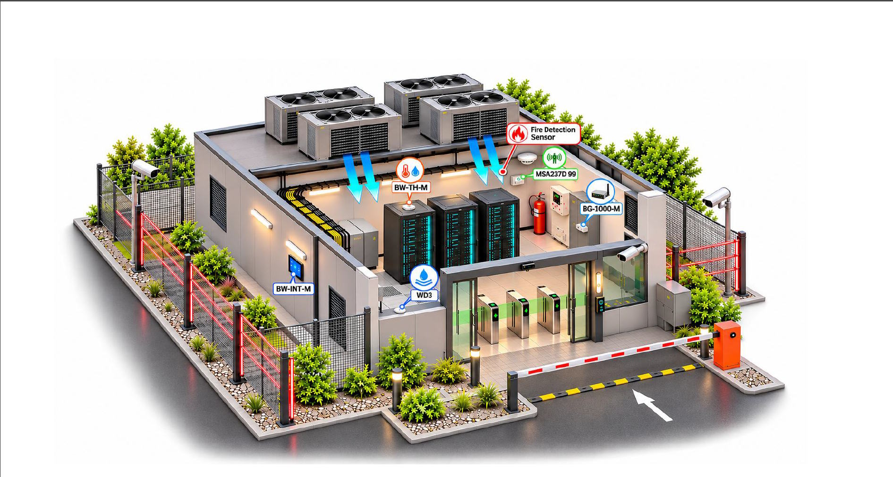

# BACnet/IP Subnet Listener & IMOPS Gateway (`bacnet-gw`)

A zero-dependency Go 1.24 BACnet/IP listener and telemetry gateway built to monitor the **Production Optergy P864 Controller** (`Device Instance: 864077`, `IP: 192.168.0.160`) and the 12 production BACnet points defined in `Optergy BACnet Points.xlsx`.

Placed on the same `192.168.0.0/24` subnet/VLAN, `bacnet-gw` automatically detects active network interfaces, discovers controllers via BACnet `Who-Is` / `I-Am` (with direct unicast fallback to `192.168.0.160:47808`), polls `Present_Value` + `Status_Flags`, listens for real-time `Unconfirmed-COV` broadcasts and wire packets, monitors controller communication health, serves a **Live Digital Twin Web Dashboard** (`http://127.0.0.1:8090/`), and delivers batched JSON telemetry to an external **IMOPS API**.

---

## Architecture Overview

### System Architecture


### Internal Go Software Architecture


### Digital Twin Dashboard Layout



---

## Production Controller & Monitored BACnet Points

Source specification: **`Optergy BACnet Points.xlsx`**

### Controller Network Parameters

| Parameter                          | Production Value                                                                |
| ---------------------------------- | ------------------------------------------------------------------------------- |
| **Controller Model**               | `Optergy P864`                                                                  |
| **BACnet Device Instance**         | `864077`                                                                        |
| **Controller IP Address**          | `192.168.0.160`                                                                 |
| **Subnet Mask / Gateway**          | `255.255.255.0` (`/24`) • `192.168.0.1`                                         |
| **Subnet Broadcast Target**        | `192.168.0.255:47808` (`0xBAC0`)                                                |
| **Other Site Controllers on VLAN** | `AXON` (`192.168.0.158`), `WBG1000` (`192.168.0.159`), `P442` (`192.168.0.161`) |

### 12 Monitored BACnet Objects on `P864` (`#864077`)

| #   | BACnet Object (`short_object_id`) | BACnet Type & Instance | Sensor / Equipment (`dashboard.jpeg` Label) | Monitored Property                     | Physical Input / LED           | Normal / Active Text & Behavior                                    |
| --- | --------------------------------- | ---------------------- | ------------------------------------------- | -------------------------------------- | ------------------------------ | ------------------------------------------------------------------ |
| 1   | `AI-101`                          | `analog-input:101`     | `BW-INT-M` (Wireless Air Touch Display)     | Temperature (`°C`)                     | `BG-1000-M` (Wireless)         | Live numeric telemetry                                             |
| 2   | `AI-102`                          | `analog-input:102`     | `BW-INT-M` (Wireless Air Touch Display)     | Humidity (`%RH`)                       | `BG-1000-M` (Wireless)         | Live numeric telemetry                                             |
| 3   | `AV-27126`                        | `analog-value:27126`   | `BW-INT-M` (Wireless Air Touch Display)     | Temperature Setpoint (`°C`)            | `BG-1000-M` (Wireless)         | Live setpoint telemetry                                            |
| 4   | `AI-201`                          | `analog-input:201`     | `BW-TH-M` (Wireless Temp & Humidity)        | Temperature (`°C`)                     | `BG-1000-M` (Wireless)         | Live numeric telemetry                                             |
| 5   | `AI-202`                          | `analog-input:202`     | `BW-TH-M` (Wireless Temp & Humidity)        | Humidity (`%RH`)                       | `BG-1000-M` (Wireless)         | Live numeric telemetry                                             |
| 6   | `BI-1`                            | `binary-input:1`       | `WD3` (Water Leak)                          | Water detected                         | `IN 1` • Dry Contact • `LED 1` | `0`: Normal / `1`: **Water Detected (Critical Alarm)**             |
| 7   | `BI-2`                            | `binary-input:2`       | `MSA237D 99` (Motion Sensor)                | Motion / presence detected             | `IN 2` • Dry Contact • `LED 2` | `0`: Clear / `1`: **Motion Detected (Active Event)**               |
| 8   | `BI-3`                            | `binary-input:3`       | `Fire Detection Sensor`                     | Fire alarm contact activated           | `IN 3` • Dry Contact • `LED 3` | `0`: Normal / `1`: **Fire Alarm (Critical Alarm)**                 |
| 9   | `BI-4`                            | `binary-input:4`       | `PERIMETER INTRUSION (MAXIBUS)`             | Intrusion Detector                     | `IN 4` • Dry Contact • `LED 4` | `0`: Secure / `1`: **Intrusion Detected (Critical Alarm)**         |
| 10  | `BI-5`                            | `binary-input:5`       | `UPS MONITORING`                            | UPS on battery / power failure         | `IN 5` • Dry Contact • `LED 5` | `0`: Mains OK / `1`: **UPS On Battery / Failure (Critical Alarm)** |
| 11  | `BI-6`                            | `binary-input:6`       | `Access Control System`                     | Unauthorized access / door forced open | `IN 6` • Dry Contact • `LED 6` | `0`: Secure / `1`: **Door Forced Open (Critical Alarm)**           |
| 12  | `BI-7`                            | `binary-input:7`       | `Server Rack Door Contact`                  | Rack door opened without authorization | `IN 7` • Dry Contact • `LED 7` | `0`: Closed / `1`: **Rack Door Opened (Critical Alarm)**           |

> **Why `polling.only_catalog_points: true` is enabled by default:**
> Real Optergy P864 controllers expose hundreds of unconfigured spare internal objects (`UI`, `BO`, `AV`, `BV`, schedules). Keeping `only_catalog_points: true` ensures `bacnet-gw` queries **strictly** these 12 production points (plus any `polling.extra_object_ids` you list), minimizing BACnet UDP traffic and keeping IMOPS payloads clean. Set `only_catalog_points: false` if you ever want full `Object_List` enumeration across all controllers on the subnet.

> **Controller Communication Loss Detection:**
> If `P864` (`#864077`) fails 2 consecutive poll cycles, `bacnet-gw` marks the controller `online: false` (`communication_status: "communication_failure"`), pulses the `P864 #864077` / `BG-1000-M` badge red on the dashboard, and posts an updated device status payload to IMOPS (automatically clearing back to `"online"` upon recovery).

### How Startup & Live BACnet Readings Work (Zero Hardcoded Values)

Every reading displayed on the Web Dashboard (`http://127.0.0.1:8090/`) and sent to IMOPS comes directly from live BACnet/IP UDP packets:

1. **Startup Discovery (`Who-Is` → `I-Am`):**
   Immediately on startup, `bacnet-gw` broadcasts a BACnet `Who-Is` frame to the selected subnet's directed broadcast IP (e.g. `192.168.0.255:47808`). Every BACnet controller on that subnet (`Optergy P864 #864077`, `AXON`, `P442`, etc.) replies with an `I-Am` packet.
2. **Metadata Sync & Immediate Initial Read (`ReadPropertyMultiple`):**
   As soon as `I-Am` is received from `P864` (`#864077`), `bacnet-gw` queries:
   - Controller metadata (`Object_Name`, `Model_Name`, `Vendor_Name`, `Firmware_Revision`)
   - Point metadata (`Units`, `Active_Text`, `Inactive_Text`) for the 12 production points (`AI-101`..`BI-7`)
   - **Initial `Present_Value` and `Status_Flags`** so the dashboard and IMOPS populate immediately on startup without waiting for the first timer tick.
3. **Continuous Live Updates (`5s Poll` + Instant `Unconfirmed-COV`):**
   - **Periodic Poll (`poll_interval_sec: 5`):** Re-reads `Present_Value` + `Status_Flags` every 5 seconds over BACnet UDP and verifies controller communication health.
   - **Instant Event Push (`SubscribeCOV`):** Subscribes to `Unconfirmed-COV` on `P864` so whenever a sensor reading drifts or a dry-contact alarm (`BI-1`..`BI-7`) activates, `P864` pushes a UDP `COV` packet immediately (<100 ms) without waiting for the 5-second poll.
   - **Wire Packet Stream:** Every decoded `Who-Is`, `I-Am`, `ReadPropertyMultiple`, and `Unconfirmed-COV` UDP frame is visible live in the **Recent BACnet/IP Wire Packets** table at the bottom of the dashboard.

---

## How to Start

### Option 1: Start Locally with Simulated Production `P864` (`#864077`)

Use the built-in simulator to test discovery, polling, `COV` alarms, the Digital Twin overlay, and IMOPS webhook batches with zero hardware.

#### 1. Terminal 1 — Start Simulated `P864 (864077)` & Mock IMOPS Server:

```powershell
.\mock-exhibition.exe
```

_(Or from source: `go run ./cmd/mock-exhibition`)_

#### 2. Terminal 2 — Start the BACnet Gateway:

```powershell
$env:IMOPS_BASE_URL="http://127.0.0.1:8085"
$env:BACNET_PORT="47809"
$env:BACNET_BROADCAST_OVERRIDES="127.0.0.1:47810"
.\bacnet-gw.exe
```

_(Or from source: `go run ./cmd/bacnet-gw`)_

#### 3. Open the Live Dashboard & Simulate Alarms:

- **Live Digital Twin Dashboard:** `http://127.0.0.1:8090/`
- **Raw Status JSON:** `http://127.0.0.1:8090/status`
- **Health Check:** `http://127.0.0.1:8090/healthz`

Trigger or clear any point live from a third PowerShell terminal to verify real-time `COV` alerts:

```powershell
# Trigger alarms (1 = Active)
Invoke-RestMethod -Method Post "http://127.0.0.1:8085/sim/set?point=BI-1&val=1"  # WD3 Water Leak
Invoke-RestMethod -Method Post "http://127.0.0.1:8085/sim/set?point=BI-2&val=1"  # MSA237D 99 Motion
Invoke-RestMethod -Method Post "http://127.0.0.1:8085/sim/set?point=BI-3&val=1"  # Fire Detection Sensor
Invoke-RestMethod -Method Post "http://127.0.0.1:8085/sim/set?point=BI-4&val=1"  # Perimeter Intrusion
Invoke-RestMethod -Method Post "http://127.0.0.1:8085/sim/set?point=BI-5&val=1"  # UPS Monitoring
Invoke-RestMethod -Method Post "http://127.0.0.1:8085/sim/set?point=BI-6&val=1"  # Access Control Door
Invoke-RestMethod -Method Post "http://127.0.0.1:8085/sim/set?point=BI-7&val=1"  # Server Rack Door

# Update wireless analog sensor value
Invoke-RestMethod -Method Post "http://127.0.0.1:8085/sim/set?point=AI-101&val=25.8"

# Reset alarms back to Normal (0 = Inactive)
Invoke-RestMethod -Method Post "http://127.0.0.1:8085/sim/set?point=BI-1&val=0"
Invoke-RestMethod -Method Post "http://127.0.0.1:8085/sim/set?point=BI-3&val=0"
```

---

### Option 2: Start on the Production `192.168.0.0/24` Subnet (Site / VAST PC)

#### Step 1 — Allow BACnet UDP Port `47808` in Windows Firewall (Run PowerShell as Administrator once)

```powershell
New-NetFirewallRule -DisplayName "BACnet-IP Gateway (UDP 47808)" -Direction Inbound -Protocol UDP -LocalPort 47808 -Action Allow
```

#### Step 2 — Select Your Subnet & Scan All Detected BACnet Devices

If your PC has multiple network adapters (e.g., WSL, Ethernet, Wi-Fi), you can list all detected subnets, interactively pick one from a numbered menu (`-select-subnet`), or pass `-subnet <CIDR|IP|AdapterName>` directly so BACnet broadcasts stay strictly on that subnet:

```powershell
# 1. List all active IPv4 subnets on this PC
.\bacnet-gw.exe -list-subnets

# 2. Interactive numbered menu: pick which subnet to scan
.\bacnet-gw.exe -select-subnet -scan

# 3. Or specify the target subnet directly (by CIDR, IP/prefix, or adapter name)
.\bacnet-gw.exe -subnet 192.168.0.0/24 -scan
.\bacnet-gw.exe -subnet "Ethernet 2" -scan

# 4. Also print every BACnet point (AI/AV/BI) and live Present_Value on each controller
.\bacnet-gw.exe -subnet 192.168.0.0/24 -scan-points
```

#### Step 3 — Create & Edit `config.yaml`

```powershell
Copy-Item config.example.yaml config.yaml
```

Configure `config.yaml` (or `.env`):

- **IMOPS Disabled (test BACnet & Web Dashboard only):** Set `imops.enabled: false` (default in `config.example.yaml`). Zero outbound HTTP calls are made, and the dashboard KPI shows `DISABLED`.
- **IMOPS Enabled (Username & Password):** Set `imops.enabled: true`, `base_url`, `username`, and `password`:
  ```yaml
  imops:
    enabled: true
    base_url: "https://api.imops.your-domain.com"
    telemetry_path: "/api/v1/bacnet/telemetry"
    devices_path: "/api/v1/bacnet/devices"
    auth_type: "basic" # "basic" (HTTP Basic username+password) | "login" (POST username+password -> token) | "bearer" | "api_key" | "none"
    username: "YOUR_IMOPS_USERNAME"
    password: "YOUR_IMOPS_PASSWORD"
  ```

#### Step 4 — Start the Gateway (With Optional Subnet Selection)

```powershell
# Start using config.yaml (or auto-detects all subnets if network.subnet is empty)
.\bacnet-gw.exe -config config.yaml

# Start on a specific subnet via CLI flag:
.\bacnet-gw.exe -subnet 192.168.0.0/24

# Or choose the subnet interactively from a numbered menu at startup:
.\bacnet-gw.exe -select-subnet
```

_(Once running, you can also switch the active subnet live at any time using the **Subnet dropdown** in the top-right header of `http://127.0.0.1:8090/`.)_

#### Step 5 (Optional) — Register as a Windows Boot Auto-Start Task

Run PowerShell as Administrator so `bacnet-gw.exe` starts automatically on system boot:

```powershell
$workDir = (Get-Location).Path
$action  = New-ScheduledTaskAction -Execute "$workDir\bacnet-gw.exe" -Argument "-config `"$workDir\config.yaml`"" -WorkingDirectory $workDir
$trigger = New-ScheduledTaskTrigger -AtStartup
Register-ScheduledTask -TaskName "ZAARR-BACnet-GW" -Action $action -Trigger $trigger -User "SYSTEM" -RunLevel Highest -Force
Start-ScheduledTask -TaskName "ZAARR-BACnet-GW"
```

---

### Option 3: Production Deployment on Ubuntu / Linux (`amd64`, `arm64`, `armv7`) with `systemd` (`systemctl`)

#### Step 1 — Compile Multi-Architecture Static Binaries (`build.bat`)

Run `build.bat` in the project root to cross-compile zero-dependency static binaries (`CGO_ENABLED=0`) into `dist\`:

```powershell
# Compile ALL platforms at once (Linux amd64/arm64/armv7 + Windows amd64/arm64 + macOS arm64)
.\build.bat

# Or compile a single target architecture:
.\build.bat linux-amd64     # Ubuntu / Debian 64-bit x86_64 (+ systemd .tar.gz bundle)
.\build.bat linux-arm64     # Ubuntu ARM64 / Raspberry Pi 4-5 / Edge Gateway (+ systemd .tar.gz bundle)
.\build.bat linux-arm       # 32-bit ARMv7 industrial gateway (+ systemd .tar.gz bundle)
.\build.bat windows-amd64   # Windows 64-bit x86_64 .exe
.\build.bat windows-arm64   # Windows ARM64 .exe
.\build.bat darwin-arm64    # macOS Apple Silicon

# Or launch an interactive numbered menu:
.\build.bat menu
```

For Linux targets, `build.bat` outputs both standalone binaries (`dist\bacnet-gw-linux-amd64`, `dist\bacnet-gw-linux-arm64`, `dist\bacnet-gw-linux-arm`) and complete ready-to-deploy `systemd` archives (`dist\bacnet-gw-linux-amd64.tar.gz` / `dist\bacnet-gw-linux-arm64.tar.gz`).

#### Step 2 — Copy Bundle to the Ubuntu / Linux Server

From your Windows machine, copy the matching `.tar.gz` archive to your Linux host (replace `<user>@<ubuntu-ip>`):

```powershell
# For 64-bit x86_64 Ubuntu server:
scp .\dist\bacnet-gw-linux-amd64.tar.gz <user>@<ubuntu-ip>:/tmp/

# (Or for ARM64 Ubuntu / Raspberry Pi / Edge Gateway:)
scp .\dist\bacnet-gw-linux-arm64.tar.gz <user>@<ubuntu-ip>:/tmp/
```

#### Step 3 — Install & Enable the `systemd` Service on Ubuntu

SSH into the Ubuntu server, extract the archive, and run `install-ubuntu.sh`:

```bash
cd /tmp
tar -xzf bacnet-gw-linux-amd64.tar.gz
cd linux-amd64
chmod +x install-ubuntu.sh
sudo ./install-ubuntu.sh
```

What `install-ubuntu.sh` sets up automatically:

- Creates dedicated unprivileged system user `bacnetgw`
- Installs `/opt/bacnet-gw/bacnet-gw` + dashboard image assets + initial `/opt/bacnet-gw/config.yaml` (copied from `config.example.yaml` if not already present)
- Allows `47808/udp` in `ufw` (if `ufw` firewall is active)
- Installs `/etc/systemd/system/bacnet-gw.service`, enables boot auto-start (`systemctl enable bacnet-gw`), and starts the daemon

##### Sample Ubuntu `systemd` Service File (`/etc/systemd/system/bacnet-gw.service`)

If you prefer to create and register the `systemd` service manually (also saved in `deploy/bacnet-gw.service`):

```ini
[Unit]
Description=Optergy P864 BACnet/IP Listener & IMOPS Gateway (bacnet-gw)
After=network-online.target
Wants=network-online.target

[Service]
Type=simple
User=bacnetgw
Group=bacnetgw
WorkingDirectory=/opt/bacnet-gw
EnvironmentFile=-/opt/bacnet-gw/.env
ExecStart=/opt/bacnet-gw/bacnet-gw -config /opt/bacnet-gw/config.yaml
Restart=always
RestartSec=5
TimeoutStopSec=15
KillSignal=SIGTERM
StandardOutput=journal
StandardError=journal
SyslogIdentifier=bacnet-gw

# Security hardening (UDP 47808 and TCP 8090 are unprivileged ports >1024)
NoNewPrivileges=true
PrivateTmp=true
ProtectSystem=full
ReadWritePaths=/opt/bacnet-gw

[Install]
WantedBy=multi-user.target
```

Manual Ubuntu registration commands:

```bash
sudo useradd --system --no-create-home --shell /usr/sbin/nologin bacnetgw || true
sudo mkdir -p /opt/bacnet-gw
sudo cp bacnet-gw-linux-amd64 /opt/bacnet-gw/bacnet-gw
sudo cp config.example.yaml /opt/bacnet-gw/config.yaml
sudo chmod +x /opt/bacnet-gw/bacnet-gw
sudo chown -R root:bacnetgw /opt/bacnet-gw
sudo chmod 750 /opt/bacnet-gw && sudo chmod 640 /opt/bacnet-gw/config.yaml

sudo cp bacnet-gw.service /etc/systemd/system/bacnet-gw.service
sudo systemctl daemon-reload
sudo systemctl enable --now bacnet-gw
```

#### Step 4 — Verify Subnet Scan & Edit Production `/opt/bacnet-gw/config.yaml`

Because `socket_linux.go` enables both `SO_REUSEADDR` and `SO_REUSEPORT` on UDP `47808`, you can run CLI scans even while the `systemd` service is running:

```bash
# 1. List all IPv4 interfaces on the Ubuntu server
/opt/bacnet-gw/bacnet-gw -list-subnets

# 2. Scan the production 192.168.0.0/24 subnet for Optergy controllers
/opt/bacnet-gw/bacnet-gw -subnet 192.168.0.0/24 -scan
/opt/bacnet-gw/bacnet-gw -subnet 192.168.0.0/24 -scan-points
```

Edit `/opt/bacnet-gw/config.yaml` with your production subnet and IMOPS API settings:

```bash
sudo nano /opt/bacnet-gw/config.yaml
```

Recommended Ubuntu server settings inside `/opt/bacnet-gw/config.yaml`:

```yaml
status_api:
  enabled: true
  listen_addr: "0.0.0.0:8090" # Use 0.0.0.0:8090 to view http://<ubuntu-ip>:8090/ from LAN, or 127.0.0.1:8090 for local-only

network:
  subnet: "192.168.0.0/24" # Lock BACnet broadcasts & listener to the Optergy subnet

imops:
  enabled: false # Keep false while testing BACnet only; set true when ready to push to IMOPS
  base_url: "https://your-imops-api-url"
  auth_type: "basic" # "basic" (username+password) or "login" (token login endpoint)
  username: "YOUR_IMOPS_USERNAME"
  password: "YOUR_IMOPS_PASSWORD"
```

Apply config changes and tail live logs:

```bash
sudo systemctl restart bacnet-gw
sudo systemctl status bacnet-gw
sudo journalctl -u bacnet-gw -f
```

#### Common `systemctl` Operations

| Action                                             | Command                            |
| -------------------------------------------------- | ---------------------------------- |
| Check service status                               | `sudo systemctl status bacnet-gw`  |
| Follow live BACnet & IMOPS logs                    | `sudo journalctl -u bacnet-gw -f`  |
| Restart after editing `/opt/bacnet-gw/config.yaml` | `sudo systemctl restart bacnet-gw` |
| Stop service                                       | `sudo systemctl stop bacnet-gw`    |
| Disable boot auto-start                            | `sudo systemctl disable bacnet-gw` |

---

## Project Structure

```text
bacnet gw/
├── build.bat                      # One-step multi-arch compiler (amd64, arm64, armv7, Windows, macOS)
├── cmd/
│   ├── bacnet-gw/main.go          # Production gateway CLI entrypoint
│   └── mock-exhibition/main.go    # Local P864 (#864077) BACnet simulator & mock IMOPS server
├── deploy/
│   ├── build-linux-amd64.ps1      # Cross-compiles static Ubuntu 64-bit (linux/amd64) bundle & tar.gz
│   ├── bacnet-gw.service          # Production systemd unit file (/etc/systemd/system/bacnet-gw.service)
│   └── install-ubuntu.sh          # Automated Ubuntu systemd service & UFW installer
├── internal/
│   ├── bacnet/
│   │   ├── types.go               # ASHRAE-135 constants, ObjectID ("AI-101"/"BI-1"), units, wire models
│   │   ├── encoding.go            # Application & context tag codec (UTF-8/16, Real, Enum, BitString)
│   │   ├── frame.go               # BVLC + NPDU (SNET/SADR routing) + APDU (Who-Is, I-Am, RP, RPM, COV)
│   │   ├── subnet.go              # Auto-detection & filtering of IPv4 interfaces & directed broadcast IPs
│   │   ├── socket_windows.go      # Windows UDP SO_BROADCAST & SO_REUSEADDR socket options
│   │   ├── socket_linux.go        # Linux UDP SO_BROADCAST, SO_REUSEADDR & SO_REUSEPORT socket options
│   │   ├── socket_unix.go         # macOS/BSD UDP socket options
│   │   └── client.go              # Concurrent UDP listener, InvokeID correlation, SegmentACK, Object_List fallback
│   ├── config/
│   │   └── config.go              # YAML / JSON / .env / ENV configuration loader & validator
│   ├── gateway/
│   │   ├── points_catalog.go      # Production 'Optergy BACnet Points.xlsx' catalog (P864 #864077, 12 points)
│   │   ├── classifier.go          # Controller & sensor equipment classifier
│   │   ├── gateway.go             # Discovery, metadata sync, polling worker pool, COV & comm-loss tracking
│   │   └── dashboard.go           # Embedded Digital Twin Web UI (:8090) mapped to dashboard.jpeg
│   ├── imops/
│   │   └── client.go              # Batched HTTP POST dispatcher, auth headers & exponential backoff retry
│   └── simulator/
│       └── exhibition.go          # Simulated Optergy P864 (#864077) & Exhibition BACnet controllers
├── Optergy BACnet Points.xlsx     # Production BACnet point list specification
├── dashboard.jpeg                 # Labeled Digital Twin facility visual served on :8090
├── config.example.yaml            # Sample YAML configuration
└── .env.example                   # Sample environment variables
```

---

## Configuration & Environment Variable Reference

| YAML Key                        | Environment Override           | Default                                   | Description                                                                                |
| ------------------------------- | ------------------------------ | ----------------------------------------- | ------------------------------------------------------------------------------------------ |
| `gateway_id`                    | `GATEWAY_ID`                   | Hostname                                  | Unique gateway identifier sent in IMOPS envelopes                                          |
| `site_name`                     | `SITE_NAME`                    | `Smart Nation Exhibition System`          | Site label shown in dashboard & IMOPS payloads                                             |
| `status_api.listen_addr`        | `STATUS_LISTEN_ADDR`           | `127.0.0.1:8090`                          | Local web dashboard & JSON diagnostics bind address                                        |
| `network.subnet`                | `BACNET_SUBNET`                | `""` (all IPv4 subnets)                   | Lock discovery & polling to a specific subnet (`192.168.0.0/24`, `192.168.0`, or NIC name) |
| `network.interface`             | `BACNET_INTERFACE`             | `""` (all IPv4 NICs)                      | Restrict subnet detection to a specific NIC name                                           |
| `network.bind_ip`               | `BACNET_BIND_IP`               | `0.0.0.0`                                 | Local UDP bind IP                                                                          |
| `network.port`                  | `BACNET_PORT`                  | `47808`                                   | BACnet/IP UDP port (`0xBAC0`)                                                              |
| `network.reuse_port`            | `BACNET_REUSE_PORT`            | `true`                                    | Sets `SO_REUSEADDR` to coexist with Optergy Studio                                         |
| `network.broadcast_overrides`   | `BACNET_BROADCAST_OVERRIDES`   | `[]`                                      | Comma-separated explicit `ip:port` discovery targets                                       |
| `network.bbmd_address`          | `BACNET_BBMD_ADDRESS`          | `""`                                      | Optional BBMD `ip:47808` for Foreign Device registration                                   |
| `polling.poll_interval_sec`     | `BACNET_POLL_INTERVAL_SEC`     | `5`                                       | Polling interval in seconds                                                                |
| `polling.subscribe_cov`         | `BACNET_SUBSCRIBE_COV`         | `true`                                    | Subscribe to real-time `Unconfirmed-COV` notifications                                     |
| `polling.only_catalog_points`   | `BACNET_ONLY_CATALOG_POINTS`   | `true`                                    | Poll strictly the 12 `Optergy BACnet Points.xlsx` objects                                  |
| `polling.extra_object_ids`      | `BACNET_EXTRA_OBJECT_IDS`      | `[]`                                      | Additional short IDs to monitor (e.g. `BI-8,AI-301`)                                       |
| `polling.forward_packet_events` | `BACNET_FORWARD_PACKET_EVENTS` | `false`                                   | Stream decoded wire packet metadata to IMOPS                                               |
| `imops.enabled`                 | `IMOPS_ENABLED`                | `true` (`false` in `config.example.yaml`) | Enable (`true`) or completely disable (`false`) IMOPS forwarding                           |
| `imops.base_url`                | `IMOPS_BASE_URL`               | `""` (dry-run)                            | External IMOPS API base URL                                                                |
| `imops.auth_type`               | `IMOPS_AUTH_TYPE`              | `basic`                                   | `basic` (username+password), `login` (POST login -> token), `bearer`, `api_key`, or `none` |
| `imops.username`                | `IMOPS_USERNAME`               | `""`                                      | IMOPS username (used by `basic` and `login` auth)                                          |
| `imops.password`                | `IMOPS_PASSWORD`               | `""`                                      | IMOPS password (used by `basic` and `login` auth)                                          |
| `imops.login_path`              | `IMOPS_LOGIN_PATH`             | `/api/v1/auth/login`                      | Token exchange endpoint when `auth_type: "login"`                                          |
| `imops.api_key`                 | `IMOPS_API_KEY`                | `""`                                      | API key value sent in `imops.api_key_header`                                               |
| `imops.bearer_token`            | `IMOPS_BEARER_TOKEN`           | `""`                                      | Token sent in `Authorization: Bearer <token>`                                              |

---

## Outbound External IMOPS API Payloads

### 1. Controller Discovery & Communication Status (`POST {base_url}/api/v1/bacnet/devices`)

Sent upon initial discovery and whenever `online` / `communication_status` changes:

```json
{
  "gateway_id": "zaarr-bacnet-gw-01",
  "site_name": "Smart Nation Exhibition System",
  "sent_at": "2026-11-12T03:45:00Z",
  "device": {
    "device_id": 864077,
    "object_name": "Optergy-P864",
    "model_name": "P864",
    "vendor_name": "Optergy",
    "vendor_id": 681,
    "firmware_revision": "4.8.2",
    "controller_role": "Optergy P864 (Production I/O Controller)",
    "address": "192.168.0.160:47808",
    "online": true,
    "communication_status": "online",
    "point_count": 12,
    "discovered_at": "2026-11-12T03:44:59Z"
  }
}
```

### 2. Batched Telemetry & Alarm Events (`POST {base_url}/api/v1/bacnet/telemetry`)

Sent every poll cycle (`source_type: "poll"`) and immediately on real-time `COV` changes (`source_type: "cov"`):

```json
{
  "gateway_id": "zaarr-bacnet-gw-01",
  "site_name": "Smart Nation Exhibition System",
  "batch_id": "20261112T034505Z-1",
  "sent_at": "2026-11-12T03:45:05Z",
  "count": 2,
  "readings": [
    {
      "timestamp": "2026-11-12T03:45:05Z",
      "source_type": "poll",
      "device_id": 864077,
      "device_name": "Optergy-P864",
      "controller_model": "P864",
      "device_address": "192.168.0.160:47808",
      "object_type": "analog-input",
      "object_instance": 101,
      "object_id": "analog-input:101",
      "short_object_id": "AI-101",
      "point_name": "BW-INT-M Temperature",
      "property_label": "Temperature",
      "dashboard_label": "BW-INT-M",
      "equipment_profile": "BW-INT-M (WIRELESS AIR TOUCH DISPLAY)",
      "connection_bus": "BG-1000-M (Wireless)",
      "value": 22.6,
      "value_text": "22.6 °C",
      "unit": "°C",
      "unit_id": 62,
      "is_triggered": false,
      "is_alarm": false,
      "quality": "good",
      "status_flags": {
        "in_alarm": false,
        "fault": false,
        "overridden": false,
        "out_of_service": false
      }
    },
    {
      "timestamp": "2026-11-12T03:45:05Z",
      "source_type": "cov",
      "device_id": 864077,
      "device_name": "Optergy-P864",
      "controller_model": "P864",
      "device_address": "192.168.0.160:47808",
      "object_type": "binary-input",
      "object_instance": 3,
      "object_id": "binary-input:3",
      "short_object_id": "BI-3",
      "point_name": "Fire Sensor",
      "property_label": "Fire alarm contact activated",
      "dashboard_label": "Fire Detection Sensor",
      "equipment_profile": "FIRE SENSOR",
      "connection_bus": "IN 3 • Dry Contact (LED 3)",
      "value": 1,
      "value_text": "Fire Alarm",
      "is_triggered": true,
      "is_alarm": true,
      "quality": "alarm",
      "status_flags": {
        "in_alarm": true,
        "fault": false,
        "overridden": false,
        "out_of_service": false
      }
    }
  ]
}
```

### 3. Decoded BACnet Wire Packets (`POST {base_url}/api/v1/bacnet/packets`)

Optional stream enabled when `polling.forward_packet_events: true`.

---

## Building from Source & Running Tests

```powershell
# Build Windows executables
go build -o bacnet-gw.exe ./cmd/bacnet-gw
go build -o mock-exhibition.exe ./cmd/mock-exhibition

# Cross-compile static Linux binary (amd64 / arm64)
$env:GOOS="linux"; $env:GOARCH="amd64"; $env:CGO_ENABLED="0"; go build -o bacnet-gw ./cmd/bacnet-gw

# Run unit and integration test suites
go test -v ./...
```

---

## Troubleshooting

- **Coexisting with Optergy Studio on the same Windows PC:** `network.reuse_port: true` sets `SO_REUSEADDR` automatically. If another BMS service holds an exclusive socket lock on `0.0.0.0:47808`, set `network.port: 47809` and `broadcast_overrides: ["192.168.0.255:47808", "192.168.0.160:47808"]` in `config.yaml`.
- **`P864` (`192.168.0.160`) not responding:**
  1. Run `ping 192.168.0.160` and `.\bacnet-gw.exe -list-subnets` to confirm the PC is on `192.168.0.0/24`.
  2. Confirm Windows Defender Firewall allows UDP `47808`.
  3. Note that `bacnet-gw` automatically sends a direct unicast `Who-Is` probe to `192.168.0.160:47808` whenever a local `192.168.0.0/24` interface is detected, so discovery succeeds even if managed switches filter UDP broadcasts.
